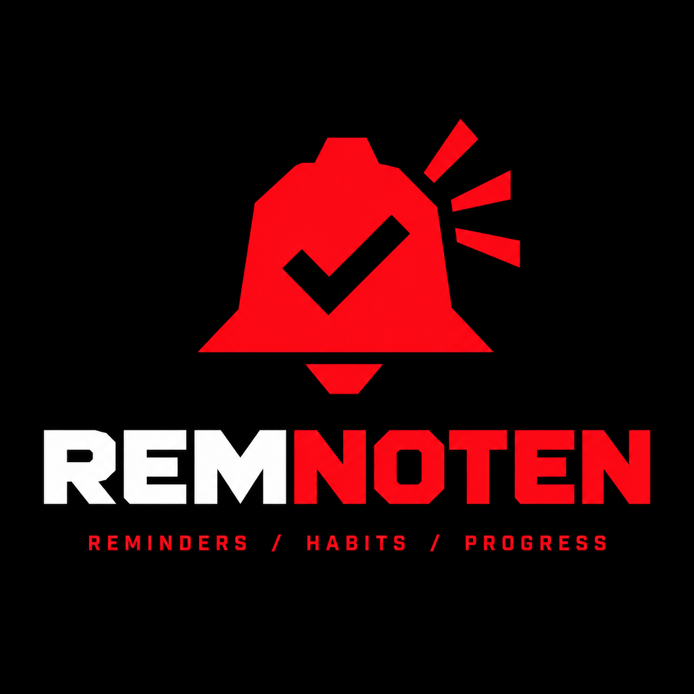
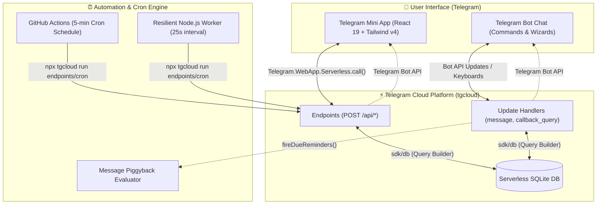

<div align="center">

  

  # Remnoten

  **The modern, all-in-one Habit Tracker, Task Manager & Smart Reminder Assistant for Telegram.**

  [](https://app8837501303.tgcloud.ai)
  [](https://react.dev/)
  [](https://vitejs.dev/)
  [](https://tailwindcss.com/)
  [](https://tgcloud.ai)
  [](.github/workflows/reminders-cron.yml)

  <br />

  <p align="center">
    <b>English</b> • <b>فارسی (RTL)</b> • <b>Русский</b>
  </p>

</div>

---

<p align="center">
  
</p>

---

## 📖 Overview

**Remnoten** is a full-featured productivity ecosystem built natively for Telegram. It combines a fast, high-performance **Telegram Mini App (TMA)** built with React 19 and Tailwind CSS with a serverless Telegram Bot running on **Telegram Cloud (`tgcloud`)**.

Whether you prefer tapping through a silky-smooth touch interface inside Telegram or interacting directly via chat commands, Remnoten helps you build lasting habits, organize daily tasks, and never miss an important reminder.

---

## ✨ Key Features

### 🔥 Habit Tracking & Streaks
- **Daily & Custom Frequencies**: Track habits daily or on custom schedules with personalized targets and measurement units (e.g., *Drink 8 Glasses of Water*, *Read 20 Pages*).
- **Streak Counter & Milestones**: Keep the fire burning with live streak counters and visual milestone indicators.
- **Contribution Heatmap**: GitHub-style interactive yearly/monthly calendar heatmap to visualize your habit consistency over time.
- **Telegram Stories Integration**: Export and share your habit streak achievement cards directly to your Telegram Story in one tap!

### 📋 Intelligent Tasks & To-Dos
- **Due Dates & Times**: Schedule tasks with an intuitive wheel picker.
- **Priority Matrix**: Organize tasks by priority (`Low`, `Medium`, `High`) with clear visual badges.
- **Smart Notification Warnings**: Get alerted before tasks are due (`At due time`, `15 min before`, `1 hour before`, `4 hours before`, `1 day before`, or custom offset).
- **Overdue Tracking**: Instant warnings when tasks slip past their scheduled deadlines.
- **Repeating Tasks**: Automatically roll over daily, weekly, or monthly recurring to-dos.

### 🔔 Smart Reminders & Natural Language Input
- **Natural Language Parsing**: Type reminders naturally in chat (e.g., `/remind tomorrow at 9:00 Team standup` or `/remind in 45 mins Call doctor`).
- **One-Time & Recurring**: Set one-time alerts or repeating frequencies (`Daily`, `Every 2 Days`, `Every 3 Days`, `Weekly`).
- **High-Priority Escalation**: High-priority reminders ping you every 10 minutes until explicitly acknowledged.
- **Quick Snooze & Conversion**: Snooze alerts for 15 minutes or convert a reminder straight into an actionable To-Do task with 1 tap.

### 📱 Silky-Smooth Telegram Mini App (TMA)
- **Fluid Modern Design**: Clean mobile-first interface optimized for Telegram iOS, Android, and Desktop.
- **8 Dynamic Accent Themes**: Switch instantly between `Crimson Red`, `Cyber Violet`, `Ocean Blue`, `Jungle Green`, `Sunset Orange`, `Pink Pastel`, `Electric Mint`, and `Rose Red`.
- **Haptic & Audio Feedback**: Tactile vibrations via Telegram WebApp Haptic API paired with smooth synthesized sound effects.
- **Long-Press Actions**: Quick action drawers for editing, resetting, or deleting items.
- **Interactive Onboarding**: Guided tutorial overlay for first-time users.

### 🤖 Telegram Bot & Wizard Integration
- **Interactive Chat Wizards**: Create habits, tasks, and reminders using multi-step inline keyboards without leaving chat.
- **Automatic Timezone Detection**: Send your location once to instantly detect and configure your timezone and UTC offset.
- **Full Trilingual & RTL Support**: Complete native translations for English (`en`), Persian (`fa` / فارسی with full RTL layout), and Russian (`ru` / Русский).

---

## 🏗️ Architecture & Technology Stack



### Tech Stack Details
- **Frontend**: [React 19](https://react.dev/), [Vite](https://vitejs.dev/), [Tailwind CSS v4](https://tailwindcss.com/), [Lucide React](https://lucide.dev/), [Radix UI](https://www.radix-ui.com/), [Geist & Vazirmatn Fonts](https://fonts.google.com/).
- **Backend**: Telegram Cloud ([`@tgcloud/cli`](https://tgcloud.ai)) V8 Isolate serverless runtime with zero runtime `node_modules` overhead.
- **Database**: SQLite-compatible serverless database managed declaratively with `sdk/db`.
- **Automation**: GitHub Actions workflow (`.github/workflows/reminders-cron.yml`) and background worker (`scripts/worker.js`).

---

## 📁 Project Structure

```
habit_bot/
├── .github/
│   └── workflows/
│       └── reminders-cron.yml    # Scheduled 5-minute GitHub Actions reminder cron
├── dist/                         # Production build output for Mini App static hosting
├── docs/
│   └── tgcloud-sdk.md            # Telegram Cloud platform SDK reference manual
├── public/                       # Static public assets (logo, banners)
├── scripts/
│   └── worker.js                 # Resilient standalone background runner for reminders
├── src/                          # Telegram Mini App Frontend
│   ├── components/               # React UI screens, dialogs, drawers, and controls
│   │   ├── HomeScreen.jsx        # Dashboard with streak, today's schedule & stats
│   │   ├── HabitsScreen.jsx      # Habit listing & quick check-ins
│   │   ├── HabitDetailScreen.jsx # Habit stats & contribution heatmap
│   │   ├── TasksScreen.jsx       # To-Do list with priority & date filtering
│   │   ├── RemindersScreen.jsx   # Active & completed reminders
│   │   ├── SettingsScreen.jsx    # Theme, language, and timezone settings
│   │   └── ShareStoryModal.jsx   # Telegram Story graphics generator
│   ├── lib/                      # Theme provider, audio synth, and i18n
│   ├── api.js                    # Telegram WebApp SDK bridge & haptics
│   ├── App.jsx                   # Mini App root & tab router
│   └── main.jsx                  # React application entry point
├── tgcloud/                      # Telegram Cloud Serverless Backend
│   ├── endpoints/                # Cloud endpoints invoked by Mini App (POST /api/*)
│   │   ├── cron.js               # Dispatches due reminders & overdue task alerts
│   │   ├── getAppState.js        # Hydrates all user data (habits, tasks, reminders)
│   │   ├── saveHabit.js          # Creates / updates habits
│   │   ├── toggleCheckin.js      # Toggles daily habit check-in status
│   │   ├── saveTodo.js           # Creates / updates tasks
│   │   ├── saveReminder.js       # Creates / updates reminders
│   │   └── sendStoryPhoto.js     # Sends rendered story card to chat for sharing
│   ├── handlers/                 # Telegram Bot API update handlers
│   │   ├── message.js            # Text commands, NLP reminders, location handler
│   │   ├── callback_query.js     # Inline buttons & multi-step wizards
│   │   └── my_chat_member.js     # Bot membership events
│   ├── lib/                      # Shared serverless utilities (i18n, timezone, parser)
│   └── schema.js                 # Database schema definitions
├── tgcloud.jsonc                 # Telegram Cloud deployment configuration
├── vite.config.js                # Vite build and plugins configuration
└── package.json                  # Scripts & dependencies
```

---

## ⏰ Reminder Dispatch Engine

Remnoten features a **triple-redundancy scheduling architecture** to ensure timely and guaranteed reminder deliveries:

1. **GitHub Actions Scheduled Cron** (`.github/workflows/reminders-cron.yml`):
   Runs automatically in the cloud every 5 minutes with zero server hosting costs.
2. **Resilient Local/Server Worker** (`scripts/worker.js`):
   Optional high-frequency runner pinging `endpoints/cron` every 25 seconds with automatic rate-limit backoff, token caching, and watchdog recovery.
3. **Message Piggybacking**:
   Whenever any user messages the bot, all pending reminders due across the system are evaluated and dispatched synchronously.

---

## 🤖 Telegram Bot Commands

| Command | Description (English) | توضیحات (فارسی) | Описание (Русский) |
|---|---|---|---|
| `/app` | Open Remnoten Mini App | باز کردن مینی‌اپ Remnoten | Открыть приложение |
| `/start` | Launch bot & view welcome menu | شروع ربات و نمایش منوی اصلی | Запустить бота |
| `/menu` | Open interactive main menu | نمایش منوی اصلی | Главное меню |
| `/add` | Add a new task (`/add [task]`) | افزودن کار جدید | Добавить задачу |
| `/todos` | View active to-do list | مشاهده لیست کارهای باز | Мои задачи |
| `/habit` | Add a new habit (`/habit [name]`) | ایجاد عادت جدید | Добавить привычку |
| `/habits` | View habits & check in | مشاهده و ثبت عادت‌ها | Мои привычки и серии |
| `/remind` | Smart reminder (`/remind [time] [task]`) | تنظیم یادآور هوشمند | Создать напоминание |
| `/reminders` | Manage active reminders | مدیریت یادآورها | Активные напоминания |
| `/language` | Switch language (EN / FA / RU) | تغییر زبان ربات | Выбрать язык |
| `/timezone` | Set timezone or send location | تنظیم منطقه زمانی | Часовой пояс |
| `/stats` | View streaks & completion rates | مشاهده گزارش و آمار | Статистика прогресса |
| `/help` | Detailed instructions & examples | راهنما و دستورات | Справка и помощь |

---

## 🚀 Getting Started & Local Development

### Prerequisites
- [Node.js](https://nodejs.org/) v20 or newer
- [npm](https://www.npmjs.com/) v10 or newer
- A Telegram Bot token from [@BotFather](https://t.me/BotFather)

### 1. Clone & Install
```bash
git clone https://github.com/sina-sparkn/Remnoten.git
cd Remnoten
npm install
```

### 2. Run Mini App Locally
Start the Vite development server with hot-module replacement (HMR):
```bash
npm run dev
```

### 3. Build the Mini App
Compile the production-ready static assets:
```bash
npm run build
```

### 4. Run the Background Reminder Worker (Optional)
Run the local background worker for sub-minute reminder dispatching:
```bash
npm run worker
```

---

## ☁️ Deployment & tgcloud Workflow

Remnoten is deployed to Telegram's serverless infrastructure using `@tgcloud/cli`.

### Authenticate
Link your project with your bot token:
```bash
npx tgcloud login
```

### Check Status & Diff
Inspect local vs. deployed changes:
```bash
npx tgcloud status
```

### Deploy (Build & Push)
Build the frontend and deploy all modules to the cloud:
```bash
npm run deploy
```

### Apply Database Migrations
If `tgcloud/schema.js` has changes, sync the database:
```bash
npx tgcloud migrate
```

### Verify Webhooks
Ensure the bot's webhook routes to your cloud handlers:
```bash
npx tgcloud webhook sync
```

---

## 🔐 Environment Variables & Secrets

For continuous reminder execution via **GitHub Actions**, set the following secret in your GitHub repository (**Settings > Secrets and variables > Actions**):

| Secret Name | Description |
|---|---|
| `TGCLOUD_TOKEN` | Your Telegram Cloud API access token obtained from `.tgcloud/` after running `npx tgcloud login`. |

---

## 🌐 Supported Languages

Remnoten provides complete, first-class localization:
- **English (`en`)** — Default international language.
- **Persian (`fa` / فارسی)** — Tailored RTL (Right-to-Left) layout with Google Vazirmatn typography.
- **Russian (`ru` / Русский)** — Full Cyrillic localization for tasks, habits, and bot flows.

Language can be switched at any time via the Mini App Settings screen or the `/language` command.

---

## 📄 License

This project is licensed under the MIT License.

<div align="center">
  <br />
  <sub>Built with ❤️ for the Telegram developer ecosystem.</sub>
</div>
